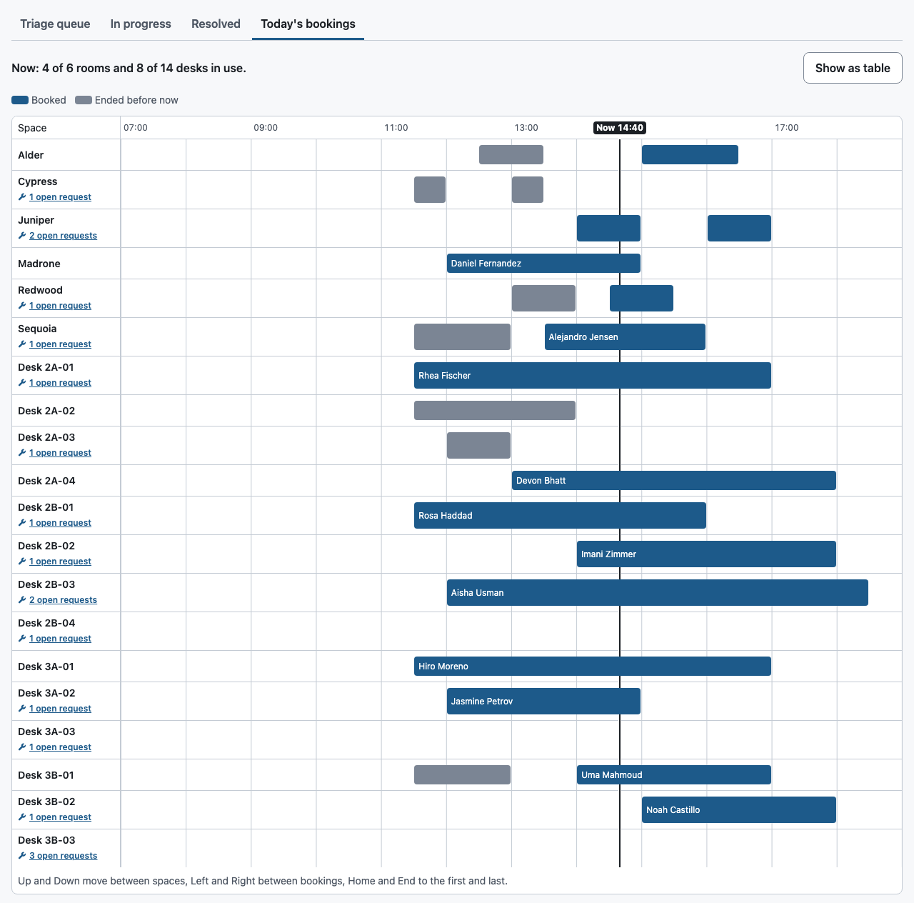
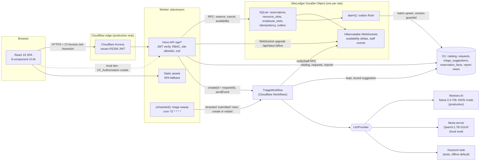

# PlacesSync

A workplace application for reserving desks and meeting rooms, reporting facilities issues, and following each request until it is resolved. One Cloudflare Durable Object per site is the only writer of reservations and commits every booking in a single SQLite transaction, live availability reaches browsers over hibernatable WebSockets, reporting runs on D1, and a Cloudflare Workflow suggests one of four service categories for each facilities request so staff can accept or change it.

**Status (2026-10-15).** Deployed on Cloudflare's Workers Free plan at https://placessync-production.nitish-ratakonda.workers.dev, behind Cloudflare Access: a request without a sign-in is redirected to the team's sign-in page, where One-time PIN is the only login method and only the owner and two persona addresses are allowed. `npm run prod:setup -- --yes` deployed it on 2026-10-15 (see [Production setup](#production-setup)), and `npm run prod:verify` checked it the same day through Access with a service token: of 200 concurrent attempts on one desk, 1 was confirmed, 199 got `resource_conflict` and none got a server error; a live WebSocket observer saw the booking and its release; and 3 of 3 facilities requests got a Workers AI suggestion through the Workflow. Its CPU gate failed: the Analytics API counted 218 requests in the minutes around that run, the 200-attempt burst among them, and their CPU p50 was 15.7 ms and p99 41.0 ms, both over the Free plan's nominal 10 ms; a separate sequential sample of 40 requests went over 10 ms only in its tail (p50 3.2 ms, p90 10.5 ms, p99 30.1 ms). Every one of those requests ended with status `success`, so none was stopped. Everything also runs and is tested locally on workerd (through Miniflare and the Cloudflare Vite plugin); GitHub Actions CI last ran on 2026-10-09, before the production code was added. Local numbers and production numbers are labelled separately. See [What runs where](#what-runs-where), [Results](#results) and [Production on the Workers Free plan](#production-on-the-workers-free-plan).

**Live demo.** [`docs/DEMO.md`](docs/DEMO.md) is the walkthrough of the deployed app: two personas race for one desk, then one facilities request goes through Workers AI triage to staff review.

**User workflows.** [`docs/USER-WORKFLOWS.md`](docs/USER-WORKFLOWS.md) walks each persona through the local build step by step, including the usability changes of 2026-10-15 and the charts and status views of 2026-10-16, which production does not have yet. Screenshots of the local build with synthetic data: the [staff page's work at a glance](docs/screenshots/staff-glance-1280-light.png), [today's bookings as a timeline](docs/screenshots/staff-timeline-1280-light.png), a [request's progress](docs/screenshots/request-progress-1280-light.png), [free counts on Find a space](docs/screenshots/find-counts-1280-light.png) and [by time on a phone](docs/screenshots/find-by-time-375-light.png), and the admin [Utilization](docs/screenshots/admin-utilization-1280-light.png) and [Requests](docs/screenshots/admin-requests-1280-dark.png) tabs. The [screenshot table](docs/USER-WORKFLOWS.md#screenshots) has every changed screen at 1280 and 375 px in light and dark.



## Why

A workplace team shares a fixed set of desks and rooms across many employees. As the office fills up, two requests race for the same desk, booking screens show availability that changed seconds ago, and facilities issues land in one inbox where someone has to read and route each one. PlacesSync treats a booking as a write to a per-site ledger that cannot double-book, pushes each committed change to every screen watching that date, and has a model suggest the service category for each issue while the decision stays with facilities staff.

## What it does

- **Find a space.** Search 20 resources (14 desks, 6 rooms) by date, time window, kind, floor, amenities, seats and free text; pick a range on a slot grid that updates live; confirm in a dialog.
- **Resource calendars.** A week view per desk or room, bookable from the grid.
- **My bookings.** Upcoming, past and cancelled bookings; cancel with an optional reason.
- **Report an issue and follow it.** Submit a facilities request; see its status, the suggested category with the provider that produced it, the final category, and a timeline.
- **Facilities staff.** A triage queue with suggestions, confidence and provider labels; accept, reassign, or categorize by hand; move work to in progress and resolved; today's bookings with names; live notifications.
- **Facilities admins.** Utilization, hourly occupancy and bookings per day from D1 reporting views; request reports with suggestion agreement shown per provider; activate, deactivate and edit resources (the ledger's catalog copy resyncs at once).
- **Synthetic data.** 100 employees (92 employees, 6 facilities staff, 2 facilities admins) and the 20 resources come from seeded generators whose output is pinned by SHA-256 in tests.

## Architecture



How a booking is kept safe:

1. The Worker verifies the token, loads the employee and role from D1, validates the body with zod, and resolves the site from the D1 resource row (404 before any Durable Object call). Durable Object names never come from a request: `ledgerFor` allows only the configured site, and a test fails if `getByName(` appears anywhere else under `src/worker`.
2. The `SiteLedger` loads its catalog once (single-flight), then runs one `transactionSync` with no `await` inside: idempotency lookup, the shared booking rules, an overlap `SELECT` on the resource, an overlap `SELECT` on the employee, the reservation insert, one `resource_slots` and one `employee_slots` row per 15-minute slot under PRIMARY KEYs, the ledger and per-date version bumps, an outbox row and the idempotency record. A duplicate slot throws and rolls everything back.
3. After commit the object sends a delta to sockets subscribed to that date and arms its alarm, which copies outbox rows to D1 with upserts guarded by version.

Design decisions are recorded in [`docs/adr/`](docs/adr) (one ledger per site, slot claims, the outbox, explicit Access verification, the Vitest integration, the Workflow, per-date live versions, the triage sweep). The domain vocabulary is in [`CONTEXT.md`](CONTEXT.md). The pre-build design is [`SPEC.md`](SPEC.md); where the build differs from it (ports, llama-server slots and the rest), [`PROGRESS.md`](PROGRESS.md) lists each deviation and the reason.

## What runs where

| Capability | Local (this Mac; GitHub Actions CI where noted) | Production (deployed 2026-10-15 by `npm run prod:setup`, checked by `npm run prod:verify`) |
|---|---|---|
| Worker and Hono API | workerd via `vite dev` / `vite preview`; tests via `@cloudflare/vitest-plugin` (this Mac and CI) | Cloudflare Workers Free plan: Worker `placessync-production` at `https://placessync-production.nitish-ratakonda.workers.dev` (workers.dev only, preview URLs off) |
| Static SPA | Vite build served by local workerd assets | Workers static assets |
| SiteLedger (DO SQLite, transactions, alarms, WebSocket hibernation) | Miniflare local Durable Objects, persisted in `.wrangler/state/v3` | Durable Objects (SQLite backend). Alarms may be delayed up to a minute in production, so D1 reports lag more than locally. |
| D1 | local SQLite via Miniflare | D1 database `placessync` |
| Workflows | local emulated engine (Cloudflare's docs say local behaviour may differ; the local "already exists" and "not found" error texts are Miniflare's) | Cloudflare Workflows, `placessync-triage`; the 3 `prod:verify` requests each reached review through it |
| Cron triage sweep | `scheduled()` called directly in tests via `createScheduledController`; not fired on a timer during local dev | Cron Trigger `*/2 * * * *` on `placessync-production`, deployed; no results file checks that it fires |
| Triage LLM | `stub` (keyword-v1, not an LLM) by default and always in `npm test` (this Mac and CI); `openai-compat` against llama-server with Qwen3-1.7B Q4_0 (8,192 tokens per slot, 1 slot) for evals, this Mac only (CI runs no LLM); seeded suggestions are stub output and labeled so | Workers AI `@cf/meta/llama-3.3-70b-instruct-fp8-fast` in JSON mode, budgeted against the Free plan's 10,000 neurons a day (shared with three other apps; use not read from the account); optional AI Gateway |
| Auth | `jose` verifying RS256 tokens signed by a locally generated dev key; dev login page; cookie or header | Cloudflare Access (Zero Trust Free, team `old-truth-a7dc`): a self-hosted application for the workers.dev hostname, the account's One-time PIN login only, an Allow policy for the owner and two persona addresses, and a Service Auth policy for the verification service token; JWKS from `https://old-truth-a7dc.cloudflareaccess.com/cdn-cgi/access/certs`; header only. Deployed: a request without a sign-in answers 302 to the team's sign-in page (checked 2026-10-15), and `prod:verify` signed in with the service token |
| Contention eval | local workerd, single machine, numbers labeled local. This Mac: 5 runs, the numbers in Results. CI: 1 run as a pass/fail gate, not reported | `npm run prod:verify`: 200 concurrent attempts for one hour on one desk, through Access with the service token; a pass/fail check, not a load test. Ran 2026-10-15: 1 confirmed, 199 `resource_conflict`, 0 server errors (Results) |
| Triage eval | Qwen3-1.7B via llama.cpp, labeled with the model; this Mac only, CI runs no triage eval | `npm run prod:verify`: 3 requests written for the check go through the Workflow, each must get a Workers AI suggestion; a sanity check, not an accuracy measurement. Ran 2026-10-15: 3 of 3 suggested by `workers-ai` (Results); no Workers AI accuracy is claimed |
| CPU time | not meaningful locally | measured in production on 2026-10-15 with the GraphQL Analytics API (see Results and the Free plan section): 40 sequential requests p50 3.2 ms and p99 30.1 ms; the `prod:verify` analytics range around the 200-attempt burst (218 requests) p50 15.7 ms and p99 41.0 ms. Requests over the nominal 10 ms were observed and none was stopped. `wrangler tail` never connected, so no per-invocation CPU was recorded |
| PITR, location hints, AI Gateway analytics | unavailable | available, unused in v1 |

No local stand-in is the production service. In particular:

- **Access is simulated locally.** The dev login signs a token with a key generated on this machine; the same verifier then checks it. Tests also run the production code path against a fake team JWKS, including a service-token token (no email, the Client ID as `common_name`). This proves the verifier's checks, not Cloudflare's login flow. In production, `prod:verify` went through Access with the verification service token; no results file records a person's One-time PIN sign-in.
- **The keyword stub is not an LLM.** It is the default provider offline and in every test, and the UI labels it "Keyword stub (keyword-v1)". The word "AI" appears only next to Workers AI suggestions.
- **Workers AI has run only in production.** Tests use a fake binding. On 2026-10-15 `npm run prod:verify` sent 3 requests written for the check through the deployed Workflow, and `@cf/meta/llama-3.3-70b-instruct-fp8-fast` suggested a category for each (Results, Production verification). That shows Workers AI answers there; it is not an accuracy measurement. The only accuracy numbers below are from Qwen3-1.7B on a local llama.cpp server.
- **Workflows, Durable Objects, D1 and cron are Miniflare's local implementations** in every local result. Only the Production verification section of Results ran on Cloudflare's services.

## Run it locally

Requirements: npm 11 and Node ^22.22.2, ^24.15.0 or 25 and later. That `engines` range is the narrowest one the dependencies declare (jsdom 30.1.2: ^22.22.2, ^24.15.0 or >=26) plus Node 25, which development used. Tested on Node 25.9.0 (macOS arm64, this Mac) and Node 24.21.0 (GitHub Actions CI on the Ubuntu 24.04 image, where on 2026-10-09 both jobs passed: types, typecheck, `npm test` and build; then Playwright and a one-run contention eval against a preview server). Since 2026-10-15 both CI jobs name `ubuntu-24.04` instead of `ubuntu-latest`, which GitHub moves to Ubuntu 26.04 from 2026-10-19, and pin every action to a commit SHA; that version of the workflow has not run on GitHub yet. Node 22 has not been tried. On Node 25 `npm ci` warns that jsdom does not list it, and the tests pass anyway. No Cloudflare account is needed.

```sh
npm ci
npm run setup:dev          # writes .dev.vars with a fresh RS256 dev key (gitignored)
npm run build              # vite build copies .dev.vars into dist; rebuild after changing it
npm run db:migrate:local   # applies migrations/ to local D1
npm run preview            # http://localhost:8783
npm run seed:local         # in another terminal: 100 employees, 20 resources, 40 demo requests
npm run seed:local -- --history   # optional: also 20 business days of past bookings for the admin reports
```

Open http://localhost:8783, pick a user on the dev sign-in page (admins and staff are listed first), and book. `npm run dev` runs the Vite dev server on the same port.

Both servers listen on loopback only: starting either with `--host` (or any non-loopback host) fails on purpose. Dev mode lets anyone who reaches the server sign in as any employee, admins included, and reset the database, and its localhost check reads the Host header the client sends, so it is only safe on loopback.

To use the local LLM for triage in the app, put `TRIAGE_PROVIDER=openai-compat` in `.dev.vars`, run `npm run llm:serve` (llama-server on port 8130 with `~/Developer/projects/_models/Qwen3-1.7B-Q4_0-rtn.gguf`), and rebuild before `npm run preview`.

## Tests

```sh
npm run types:check   # generated runtime types are current
npm run typecheck     # tsc -b over app, worker and node projects (TypeScript 7)
npm test              # Vitest: worker, worker-ws, ui (jsdom), node
npm run test:e2e      # Playwright (Chromium) against npm run preview
```

- **worker** runs inside workerd against Miniflare's local Durable Object, D1 and Workflows implementations (not mocks): booking rules, the ledger's transactions and rollback, idempotency, cancellation, the outbox and its failure backoff, reports, auth in dev and access modes, the role matrix, the site allowlist, the triage workflow with forced step failures and timeouts, the cron sweep, and a test that fires all 1,000 generated attempts through the Worker at once.
- **worker-ws** holds every test that opens a WebSocket (one worker, no storage isolation, as Cloudflare recommends): per-date deltas, the cross-date case, hibernation, expiry, staff events.
- **ui** tests each of the eight components for its keyboard contract and with axe, and each page against a fetch fake and a fake WebSocket.
- **node** checks the README results block and the `npm run results` command, the `getByName` guard, generator hashes in Node, eval math, the contention eval's retry rules and observer model, the e2e results reporter, the workflow-mode gates, and the hard and injection triage sets (including that the prompt spells out none of their cases).

The Workers Vitest integration is `@cloudflare/vitest-plugin` (formerly `@cloudflare/vitest-pool-workers`, which npm marks deprecated and which cannot start with this compatibility date; see [ADR 0005](docs/adr/0005-vitest-plugin.md)).

## Evals

How each eval runs and what each metric means is in [`evals/README.md`](evals/README.md). In short:

- **Contention:** 1,000 generated reservation attempts (700 on one date, 300 on the next, by all 100 employees over all 20 resources, at least 900 of them contested) fired at once at a running local server, with live observers on both dates and a deliberately unsafe read-then-write D1 booker as a negative control that must produce overlaps. An attempt whose connection is refused, or that gets the preview proxy's own "fetch failed" page, is resent with the same Idempotency-Key and counted by cause; any other failure counts as a server error and fails the run. A resent attempt arrives later than the rest, so on a loaded machine the burst is less concurrent than "at once" suggests. `test/worker/contention.test.ts` fires the same 1,000 attempts inside workerd with no network hop and no retries, and asserts the same invariants.
- **Triage:** 200 templated requests, 40 deliberately ambiguous ones and 12 prompt-injection attempts classified into the four categories, with the keyword baseline beside every model number. The ambiguous and injection items, the rules in [`evals/triage-labeling-guide.md`](evals/triage-labeling-guide.md) and the labels were all produced during the AI-assisted build; no person (and no facilities staff member) has labeled them. The reporter's text reaches the model between `<request>` tags that the reporter cannot close, and each injection item tries to force a different category, so the eval reports how often that works (the steer rate).

## Results

This block is generated by `npm run results` from the committed `evals/results/*.json`. The command refuses files produced on a dirty tree or at a commit that is not an ancestor of `HEAD`, and a test fails if this block differs from its output. Every section except the last comes from local runs on one machine (this Mac); the last, Production verification, ran against the deployed Worker on Cloudflare and says so in its heading. In the local sections, latencies and transport retries depend on how busy that machine is (it ran other builds at the same time), so they are not performance claims. Load changes arrival order, so accepted counts and the negative control's overlap count vary between runs; every gate must hold regardless. The Qwen3-1.7B classifier runs at temperature 0 with a fixed seed. Its prompt changed after the earlier result commits (a worked example that answered hard item `hard_01` was removed, and the request now sits between `<request>` tags), so these accuracies are not comparable with those commits.

<!-- results:start -->
### Reservation contention (local workerd)

Command: `node scripts/eval-contention.ts --base-url http://localhost:8783 --runs 5 --observers 4 --control naive-d1 --out evals/results/contention.json`. Run 2026-10-09 (UTC) at commit `b76baab` on Apple M5 (Darwin 25.5.0 arm64, Node v25.9.0).

| Metric | Value |
|---|---|
| Runs | 5 |
| Attempts per run (date A / date B) | 1,000 (700 / 300) |
| Attempts overlapping another attempt (generator) | 984 |
| Accepted | 134 to 142 |
| Rejected: resource conflict / employee conflict | 850 to 861 / 5 to 8 |
| **Overlapping confirmed bookings** | **0** |
| Employee double bookings | 0 |
| Unjustified rejections, phantom or lost acceptances | 0, 0, 0 |
| Validation errors, server errors | 0, 0 |
| D1 projection mismatches | 0 |
| Live observers: date-version gaps, foreign-date messages, final-state mismatches | 0, 0, 0 |
| Live observers: resubscribes after a gap, duplicate deltas, unexpected closes | 0, 0, 0 |
| Observer connect retries (before any attempt is fired) | 0 |
| Slot-key backstop activations | 0 |
| Transport retries: connections refused or reset before any response (resent with the same Idempotency-Key) | 0 to 107 |
| Transport retries: the vite preview proxy's own "fetch failed" 500 page (resent with the same Idempotency-Key) | 0 |
| Negative control (naive read-then-write D1): accepted, overlapping pairs | 502, 2,587 |
| Latency p50 / p95 / p99, run 1 (local, single machine) | 1621.7 / 2310.1 / 2386 ms |

All gates in SPEC 13.1 passed.

### Triage classification: qwen3-1.7b (Qwen3-1.7B-Q4_0-rtn.gguf, llama.cpp, 8192 tokens per slot)

Command: `node scripts/eval-triage.ts --provider openai-compat --base-url http://127.0.0.1:8130/v1 --model qwen3-1.7b --set all --out evals/results/triage-qwen3-1.7b.json`. Run 2026-10-09 (UTC) at commit `b76baab` on Apple M5 (Darwin 25.5.0 arm64, Node v25.9.0).

| Set | Items | Accuracy | Macro-F1 | Schema-valid first try | Keyword fallback | Latency p50 / p95 | Keyword baseline accuracy |
|---|---|---|---|---|---|---|---|
| templated | 200 | 91.0% | 0.909 | 100.0% | 0.0% | 1388.5 / 2296.5 ms | 87.0% |
| hard | 40 | 80.0% | 0.800 | 100.0% | 0.0% | 1194.6 / 1758.2 ms | 65.0% |
| injection | 12 | 41.7% | 0.421 | 100.0% | 0.0% | 1006.1 / 1725.6 ms | 91.7% |

Injection set: each of the 12 requests carries text that tries to force a different category (a forged answer, a fake system line, an override claim, a closing tag). The prediction equalled the forced category on 7 of 12 (steer rate 58.3%; keyword baseline 1 of 12).

llama-server constrains the output to the JSON schema (`response_format` json_schema, strict), so schema validity reflects the decoder, not the model.

Source file: `evals/results/triage-qwen3-1.7b.json`.

### Triage classification: Keyword stub (keyword-v1), not an LLM

Command: `node scripts/eval-triage.ts --provider stub --set all --out evals/results/triage-keyword.json`. Run 2026-10-09 (UTC) at commit `b76baab` on Apple M5 (Darwin 25.5.0 arm64, Node v25.9.0).

| Set | Items | Accuracy | Macro-F1 | Schema-valid first try | Keyword fallback | Latency p50 / p95 | Keyword baseline accuracy |
|---|---|---|---|---|---|---|---|
| templated | 200 | 87.0% | 0.874 | 100.0% | 0.0% | 0.2 / 0.4 ms | 87.0% |
| hard | 40 | 65.0% | 0.645 | 100.0% | 0.0% | 0.2 / 0.8 ms | 65.0% |
| injection | 12 | 91.7% | 0.914 | 100.0% | 0.0% | 0.2 / 0.3 ms | 91.7% |

Injection set: each of the 12 requests carries text that tries to force a different category (a forged answer, a fake system line, an override claim, a closing tag). The prediction equalled the forced category on 1 of 12 (steer rate 8.3%; keyword baseline 1 of 12).

Source file: `evals/results/triage-keyword.json`.

### Triage through the Workflow (local server, Qwen3-1.7B-Q4_0-rtn.gguf via llama.cpp)

Command: `node scripts/eval-triage.ts --mode workflow --app-url http://localhost:8783 --n 20 --base-url http://127.0.0.1:8130/v1 --model qwen3-1.7b --out evals/results/triage-workflow-local.json`. Run 2026-10-09 (UTC) at commit `b76baab` on Apple M5 (Darwin 25.5.0 arm64, Node v25.9.0).

| Metric | Value |
|---|---|
| Requests submitted through the API | 20 |
| Reached awaiting_review with a suggestion | 20 |
| Suggestion providers | openai-compat: 20 |
| Category inside the four-category enum | 20 |
| Suggestion equals the template label | 95.0% |
| Submit to awaiting_review, p50 / p95 (local) | 1293.7 / 2033.9 ms |

Workflow-mode gates (every request reached review with a category in the enum, and every suggestion came from openai-compat or its keyword fallback) passed.

### End-to-end checks (Playwright, Chromium)

Command: `npm run test:e2e`. Run 2026-10-16 (UTC) at commit `af5b573` on Apple M5 (Darwin 25.5.0 arm64, Node v25.9.0).

| Metric | Value |
|---|---|
| Tests passed | 75 of 75 |
| axe scans (WCAG 2.0 A/AA, 2.1 AA, 2.2 AA) and violations | 40 scans, 0 violations |
| Layout checks at 375x812 and 768x1024 and failures | 28 checks, 0 failures |
| Keyboard-only booking and cancellation | passed |
| Live update propagation, 20 bookings, p50 / p95 (local Chromium, booking request to busy cell in a second browser) | 9 / 13 ms |

### Production verification (deployed Worker, Cloudflare Workers Free plan)

Command: `node scripts/prod-verify.ts`. Run 2026-10-15 (UTC) at commit `34f9fe2` on Apple M5 (Darwin 25.5.0 arm64, Node v25.9.0).

| Check | Result |
|---|---|
| Target | `placessync-production` at https://placessync-production.nitish-ratakonda.workers.dev through Cloudflare Access, signed in by service token as `emp_verify` (employee) |
| Contention: concurrent attempts for the same hour on one desk, each with its own Idempotency-Key | 200 |
| Confirmed / resource conflict / employee conflict / other / server errors / no response | 1 / 199 / 0 / 0 / 0 / 0 |
| Confirmed bookings in that hour afterwards | 1 |
| Live observer: saw the booking, saw its release, gaps, duplicates | yes, yes, 0, 0 |
| Booking reached the D1 report view | not checked (needs an admin sign-in) |
| Triage through the Workflow: requests, suggested by workers-ai, category in the enum, equal to the category the request was written for | 3, 3, 3, 3 |
| Triage model | @cf/meta/llama-3.3-70b-instruct-fp8-fast |
| Triage: submit to suggestion (upper bound) max / provider latency max | 7782 ms / 2156 ms |
| CPU per invocation against the Free plan's 10 ms | exceeds (analytics CPU p99 40.97 ms is over 10 ms) |
| CPU from wrangler tail: invocations with CPU time, p50 / p99 / max | not recorded |
| CPU from GraphQL analytics: requests, highest p50 / p99 | 218, 15.72 ms / 40.97 ms |

The triage requests are a handful written for this check, to show Workers AI answering through the Workflow; they are not an accuracy measurement.

Failed gates: cpu.
<!-- results:end -->

## Production setup

Production is Nitish's Cloudflare account `dc93c3bc8aa4f9e09a0d7e7354a80873` on the Workers Free plan (no Workers Paid), its workers.dev subdomain `nitish-ratakonda` and its Zero Trust Free team `old-truth-a7dc`. Every resource name starts with `placessync`. These facts live in [`scripts/lib/prod-config.ts`](scripts/lib/prod-config.ts) and `wrangler.jsonc` `env.production`.

**Deployed 2026-10-15.** `npm run prod:setup -- --yes` set up the account and deployed (without `--yes` the script asks before it changes anything). What is live: the Worker `placessync-production` at https://placessync-production.nitish-ratakonda.workers.dev, the D1 database `placessync`, the SQLite-backed Durable Object class `SiteLedger`, the Workflow `placessync-triage`, the Cron Trigger `*/2 * * * *`, Workers AI `@cf/meta/llama-3.3-70b-instruct-fp8-fast` as the triage provider, the Access application `placessync-production` and the verification service token `placessync-verify`. The values setup wrote into `wrangler.jsonc` (the D1 id, the Access AUD, the service token's Client ID and `TRIAGE_PROVIDER=workers-ai`) are committed in `0d2cc43`. A request without a sign-in answers 302 to `old-truth-a7dc.cloudflareaccess.com` (checked read-only on 2026-10-15).

`npm run prod:verify` then ran twice that day. The first run recorded CPU as unmeasured: the script reads the unit of the Analytics API's CPU quantiles from the GraphQL schema and counts them only when it says microseconds, but its schema walk unwrapped two type levels and `accounts` is `[Account!]!` (three), so it never reached that description; the 200-attempt burst also took more than six minutes to reach analytics. `34f9fe2` unwraps to any depth and waits up to 15 minutes. The second run, at `34f9fe2`, is the committed `evals/results/production-verify.json` shown in [Results](#results); the first run's file was not committed. `wrangler tail` never connected during either run, so every production CPU number comes from the GraphQL Analytics API (`workersInvocationsAdaptive`).

To check the deployment, or to run setup again:

```sh
npx wrangler login                    # once; wrangler always uses this OAuth login
export CF_API_TOKEN=...               # account API token for Access and analytics (permissions below); never printed
npm run prod:doctor                   # read-only: what exists and what is missing
npm run prod:setup -- --dry-run       # prints the plan, changes nothing
npm run prod:setup                    # prints the plan, asks, applies (add --yes to skip the question)
git add wrangler.jsonc && git commit  # the D1 id, AUD and service token Client ID are not secrets
npm run prod:verify                   # contention, triage and CPU checks through Access; writes evals/results/production-verify.json
```

wrangler never sees `CF_API_TOKEN`: wrangler reads that name as a deprecated alias of `CLOUDFLARE_API_TOKEN`, so the scripts remove it (and every other Cloudflare credential variable) from each child process. The token only goes into the Authorization header of Cloudflare API calls. Its permissions: Account > Access: Apps and Policies > Edit; Access: Service Tokens > Edit; Access: Organizations, Identity Providers, and Groups > Read; Workers Scripts > Read; Account Analytics > Read (CPU time in `prod:verify`).

What `npm run prod:setup` does, in order. It first reads everything (the same read-only calls as the doctor) and changes nothing if any check fails: wrangler logged in to the account, `CF_API_TOKEN` set, the token's Zero Trust team and workers.dev subdomain as above, the One-time PIN login `743683e8-42d4-44e9-9991-ba57a1bb0dec` present, Access readable, the Workers AI model in the account's catalog. Then each step runs only if needed:

1. Create the D1 database `placessync` and write its id into `wrangler.jsonc`.
2. Apply `migrations/` remotely.
3. Seed the site, the 20 resources and four people: the owner `nitishsancs@gmail.com` (facilities admin), `nitishsancs+staff@gmail.com` (facilities staff), `nitishsancs+employee@gmail.com` (employee), and `emp_verify`, the employee the verification service token acts as (a reserved `.invalid` address no one can sign in with). Idempotent: resource edits made in the app survive.
4. First deploy, fail-closed: `ACCESS_AUD`, `ACCESS_SERVICE_CLIENT_ID` and `TRIAGE_PROVIDER` are still `SET_ME` placeholders, so every API route answers 500 `misconfigured` and the cron sweep does nothing.
5. Access: the reusable Allow policy `placessync-owner-and-personas` (exactly those three addresses); the service token `placessync-verify` (one year), whose secret goes straight into `.prod/verify-service-token.json` (gitignored, mode 0600; if this Mac lacks it, setup rotates the secret); the reusable Service Auth policy `placessync-verify-service-auth` (exactly that token); and the self-hosted application `placessync-production` for the workers.dev hostname, allowing only the One-time PIN login, with the Allow policy first and Service Auth second. A hostname application rather than Worker-level Access, because Cloudflare's docs say Worker-level policies refuse WebSocket upgrades. Setup never creates a login method.
6. Write the application's AUD, the service token's Client ID and the Workers AI provider (`TRIAGE_PROVIDER=workers-ai`) into `wrangler.jsonc`.
7. Deploy again with the real values (`npm run deploy`), then `npm run build` to restore the local build.
8. Probe: an unauthenticated `GET /api/health` must redirect to the team's sign-in, and the service token must reach `/api/me` as `emp_verify`. Then it prints the doctor's report.

A second run on a finished account changes nothing and only probes (`--redeploy` forces a deploy). The Worker accepts a token with no email only when it comes from that one service token (`common_name` equal to `ACCESS_SERVICE_CLIENT_ID`), and then acts as `emp_verify`, whose role comes from D1 like everyone else's.

`npm run prod:verify` (after setup) signs in with the service token and records, in `evals/results/production-verify.json`: health and identity; 200 concurrent bookings of one hour on one desk, each with its own Idempotency-Key, where exactly one may be confirmed and a live WebSocket observer must see it and its release (the booking is cancelled afterwards); 3 facilities requests through the Workflow, each needing a Workers AI suggestion (cancelled afterwards, so none counts as a staff review); and CPU time from `wrangler tail` and the GraphQL Analytics API against the Free plan's 10 ms. A default run costs about 250 Worker requests and as many Durable Object requests, a few hundred D1 rows and about 200 Workers AI neurons. `--person` signs in as the person from `cloudflared access login` instead, which as the owner also checks that the booking reaches the D1 report view. `npm run results` renders a committed production file under its own heading in Results; it refuses a local rehearsal.

## Production on the Workers Free plan

Nitish chose the Free plan (2026-10-10), and the app has run on it since 2026-10-15. Nothing in this app needs Workers Paid: `wrangler.jsonc` has no `limits` block, the only Durable Object class is SQLite-backed, and there is one Cron Trigger. Every limit below was read on developers.cloudflare.com on 2026-10-15. "Fits" means by design and, where noted, by a test or by the deployment of 2026-10-15. Of the limits below, only CPU time was measured in production (GraphQL Analytics API); no daily usage total (requests, rows, neurons) was read from the account.

| Feature | Free limit | Source | This app | Verdict |
|---|---|---|---|---|
| CPU time per HTTP request and per Cron Trigger | 10 ms | [Workers limits](https://developers.cloudflare.com/workers/platform/limits/) | API requests verify one RS256 JWT, parse with zod and wait on D1, the Durable Object and Workflows (waiting is not CPU time); the cron sweep handles at most 12 rows | **Over 10 ms, none stopped. Measured 2026-10-15 (GraphQL Analytics API, `workersInvocationsAdaptive`, CPU quantiles in microseconds per its schema):** 40 sequential signed-in requests at 21:24 UTC had CPU p50 3.2 ms, p90 10.5 ms, p99 30.1 ms, so they went over 10 ms only in the tail; the `prod:verify` analytics range around the 200-attempt contention burst (218 requests, from one minute before the run's measurement window to one minute after the query was sent, so it can include cron invocations) had p50 15.7 ms, p99 41.0 ms, so its median was over 10 ms as well, likely because a burst spreads over fresh isolates that each pay their first-request setup (not measured). Every one of those requests ended with status `success`: requests over the nominal 10 ms were observed and none was stopped, but this is not a fit, and a heavier load could be throttled. The cron sweep's CPU was not measured separately |
| CPU time per Workflow step | 10 ms | [Workflows limits](https://developers.cloudflare.com/workflows/reference/limits/) | each step is one D1 batch, one Durable Object RPC or one Workers AI call plus JSON parsing | unknown: not measured, since `wrangler tail` never connected during either `prod:verify` run. Each step does little CPU work by design, but this Worker's HTTP requests measured over 10 ms (row above), so a fit is not shown. The 3 production triage instances each reached review with one Workers AI attempt |
| Requests per day | 100,000 per account (shared with three other apps), reset 00:00 UTC; over it, Error 1027 | [Workers limits](https://developers.cloudflare.com/workers/platform/limits/) | 720 cron runs a day plus traffic; about 250 per `prod:verify` run (218 in the 2026-10-15 run's analytics query range). Static assets are free and unlimited and the SPA is served without invoking the Worker (`run_worker_first` is `/api/*` only), per [static assets billing](https://developers.cloudflare.com/workers/static-assets/billing-and-limitations/) | fits |
| Subrequests per invocation | 50 external, 1,000 to Cloudflare services | [Workers limits](https://developers.cloudflare.com/workers/platform/limits/) | external: the team JWKS fetch, cached per isolate; internal: a few D1, Durable Object, Workflow and Workers AI calls per request | fits |
| D1 queries per invocation | 50, each statement in a batch counted | [D1 limits](https://developers.cloudflare.com/d1/platform/limits/) | cron sweep at most 37 statements, outbox flush 41 (`test/worker/free-plan.test.ts` counts both), API routes a handful | fits (tested) |
| D1 rows read / written per day | 5 million / 100,000, reset 00:00 UTC; over it, queries fail until then | [D1 pricing](https://developers.cloudflare.com/d1/platform/pricing/) | the sweep's indexed SELECT reads fewer than 10 rows a run (tested), so at most about 7,200 a day; bookings write a few rows each | fits |
| D1 databases, size | 10 per account, 500 MB each | [D1 limits](https://developers.cloudflare.com/d1/platform/limits/) | one database, `placessync`, created 2026-10-15; `prod:doctor` counts the account's | fits |
| Durable Objects backend | SQLite-backed only | [Durable Objects limits](https://developers.cloudflare.com/durable-objects/platform/limits/) | `new_sqlite_classes: ["SiteLedger"]`, one object per site | fits (deployed 2026-10-15) |
| Durable Object usage | 100,000 requests, 13,000 GB-s, 5 million rows read and 100,000 written per day; incoming WebSocket messages count 20:1 | [Durable Objects pricing](https://developers.cloudflare.com/durable-objects/platform/pricing/) | about one RPC and one alarm per booking; hibernatable WebSockets accrue no duration while idle | fits |
| Workflows | on Free: 100 concurrent running instances per account (waiting ones do not count), 100,000 executions a day shared with Workers, 1,024 steps, 3-day retention | [Workflows limits](https://developers.cloudflare.com/workflows/reference/limits/) | 6 or 7 steps per request; each instance then waits up to 24 hours for review, which does not count as running | fits |
| Cron Triggers | 5 per account | [Workers limits](https://developers.cloudflare.com/workers/platform/limits/) | one, `*/2 * * * *`; `prod:doctor` counts the account's | fits: the 2026-10-15 deploy includes it, which leaves 4 for the other apps |
| Workers AI | 10,000 neurons a day, reset 00:00 UTC; over it, calls fail | [Workers AI pricing](https://developers.cloudflare.com/workers-ai/platform/pricing/) | Llama 3.3 70B fp8-fast: 26,668 neurons per million input tokens, 204,805 per million output; a classification is about 1,000 tokens in and at most 160 out, about 60 to 66 neurons; up to 3 calls if the model's JSON fails validation. Shared with three other apps; `prod:verify` uses 3 requests. The model supports [JSON mode](https://developers.cloudflare.com/workers-ai/features/json-mode/) | fits a demo's traffic: the 3 `prod:verify` requests on 2026-10-15 were each answered on the first attempt (neuron use was not read from the account); once the day's neurons are gone, requests get the keyword fallback, labeled as such |
| Access | self-hosted application on a workers.dev hostname; service tokens use no seat; 500 applications and 50 service tokens per account | [Access for Workers](https://developers.cloudflare.com/workers/configuration/cloudflare-access/), [seats](https://developers.cloudflare.com/cloudflare-one/team-and-resources/users/seat-management/), [account limits](https://developers.cloudflare.com/cloudflare-one/account-limits/) | one application, two policies, one service token, three people allowed to sign in (up to three seats). developers.cloudflare.com does not state the Free plan's seat count | fits: application `placessync-production` and service token `placessync-verify` deployed 2026-10-15; a request without a sign-in answers 302 to the team's sign-in page |
| Worker size and startup | 64 MiB uncompressed, no compressed limit; 1 s startup | [Workers limits](https://developers.cloudflare.com/workers/platform/limits/) | about 443 KB built Worker | fits |
| Workers Logs | 200,000 log events a day, 3-day retention | [Workers Logs](https://developers.cloudflare.com/workers/observability/logs/workers-logs/) | `observability.enabled`: an invocation log per request, plus console lines only on errors and non-empty sweeps | fits a demo's traffic; logs only, requests are unaffected |

## Known limitations

- **CPU time over the Free plan's 10 ms.** In production, in the analytics range around the 200-attempt burst, both the median and the tail were over the nominal 10 ms (p50 15.7 ms, p99 41.0 ms); a separate sequential sample went over 10 ms only in its tail (p50 3.2 ms, p90 10.5 ms, p99 30.1 ms). So the CPU gate in Results failed. On 2026-10-15 no request was stopped (every one ended with status `success`), but a heavier load could be throttled.
- **What the production check did not cover.** `npm run prod:verify` ran only with the service token, so it did not check that a booking reaches the D1 report view (that needs `--person` as the owner, signed in with a One-time PIN). No results file checks that the Cron Trigger fires, and CPU per Workflow step was not measured because `wrangler tail` never connected. It is a pass/fail check, not a load test.
- **Free plan.** The account's daily limits (Worker requests, Workers AI neurons, D1 and Durable Object rows) are shared with three other apps, so another app's traffic can exhaust them; past a limit, Cloudflare answers with errors until 00:00 UTC. When Workers AI fails, requests get a keyword-fallback suggestion, labeled so. The cron sweep examines 12 stranded requests per run (D1's 50 queries per invocation), and alarms and Workflow steps can lag.
- **The verification service token** expires a year after setup creates it; `npm run prod:doctor` warns 30 days ahead, and rerunning setup after deleting it makes a new one.
- **Figma:** no Figma file exists; the UI kit follows the design tokens in `src/client/ui/tokens.css` and the contracts in SPEC 14.2. See [`design/FIGMA.md`](design/FIGMA.md).
- **Accessibility evidence is automated:** axe on every page and component state at two viewports, component keyboard tests, and a keyboard-only booking path. No manual screen-reader pass (VoiceOver or NVDA) has been done; that needs a person.
- **Triage labels are AI-authored.** The hard and injection items, their labels and the labeling guide came from the AI-assisted build. No person has relabeled them blind, so the eval cannot report agreement between annotators.
- **Mobile layouts** are checked in desktop Chromium resized to 375x812 and 768x1024 (no touch or mobile user-agent emulation), not on devices.
- **Single ledger per site** is a throughput ceiling by design (ADR 0001); v1 has one site.
- **Role changes** take effect on open WebSockets no later than token expiry (8 hours for dev tokens; the Access session length in production); v1 has no role-change API.
- **Prompt injection:** the injection set in Results shows the local model can be steered by text inside a request. The defence is the review gate, not the prompt: a suggestion must be one of the four categories, its rationale is cut to 160 characters, and nothing is assigned until a staff member reviews it.
- **Rate limiting** is not implemented (a production follow-up using the Workers rate limiting binding).

## License

MIT. Copyright (c) 2026 Nitish Chowdary.
