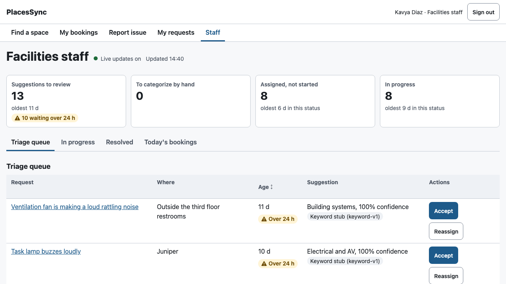
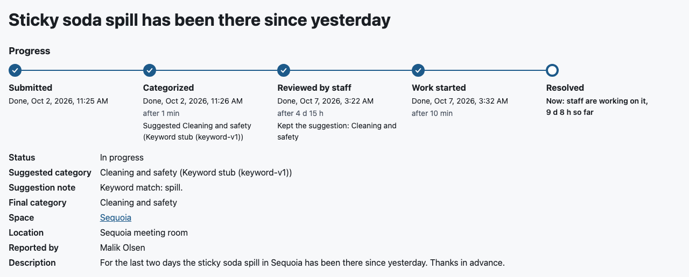
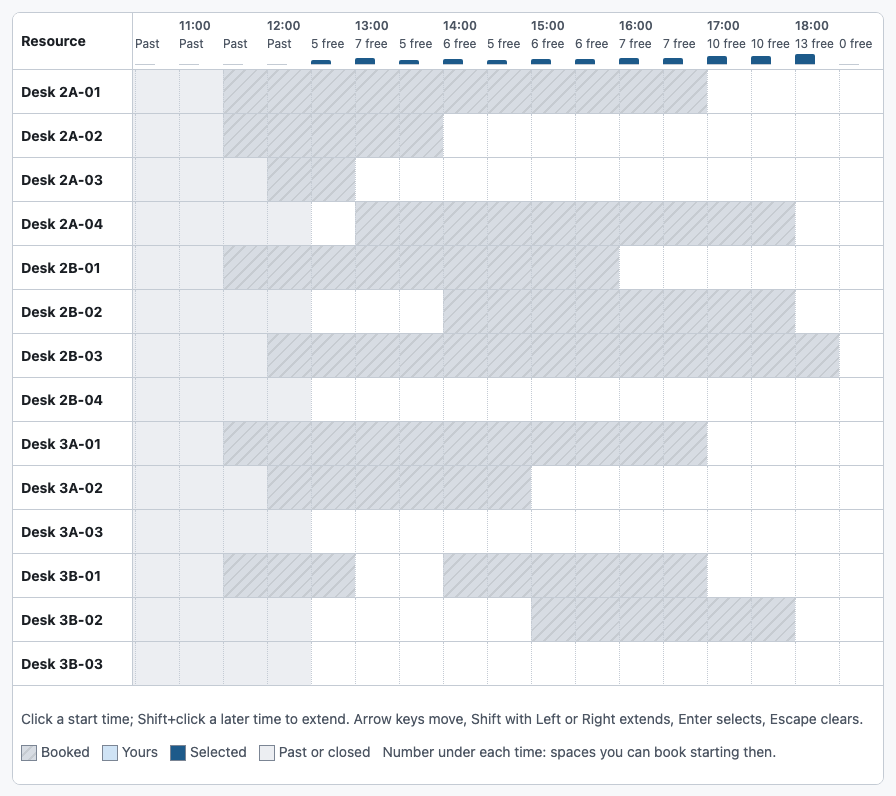
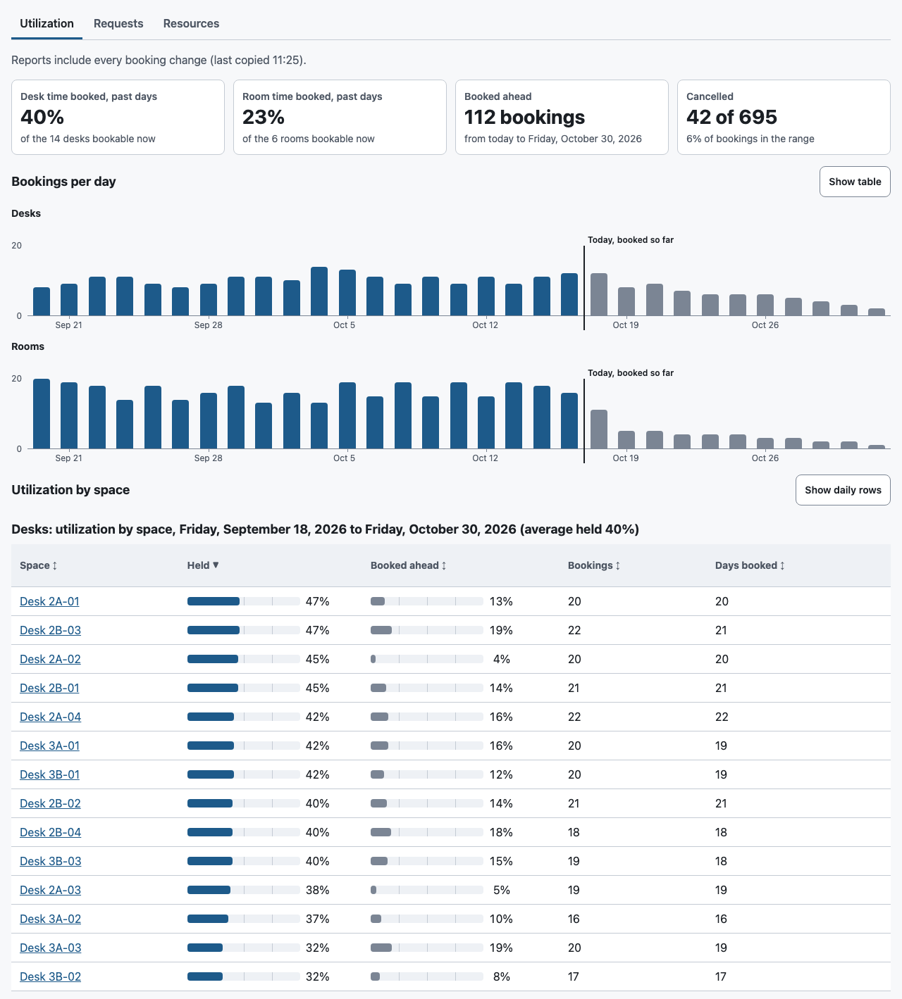
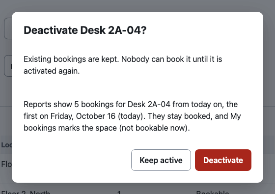
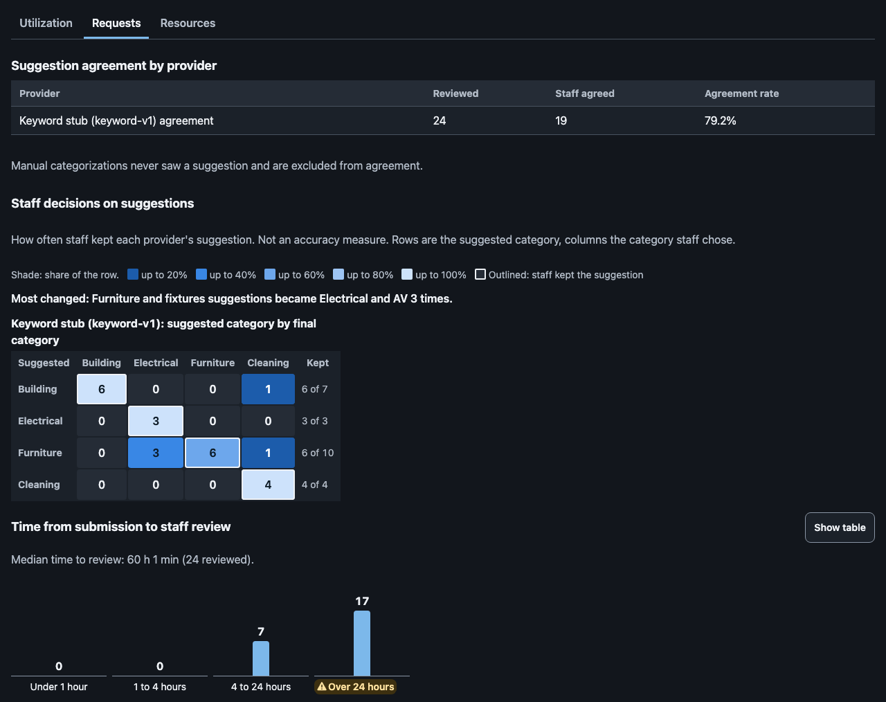

# User workflows

How each kind of person moves through PlacesSync, step by step, as the code at this commit behaves. It covers the local build. Production was deployed on 2026-10-15 before the changes listed at the end (the usability round, its second pass and the visual pass of 2026-10-16) and has not been redeployed since, so the deployed app still behaves as [`DEMO.md`](DEMO.md) describes. Labels in quotes are the exact text on screen.

The people are the synthetic ones the seed creates: 92 employees, 6 facilities staff and 2 facilities admins (`CONTEXT.md`). Staff and admins can do everything an employee can.

## Developer or presenter running it locally

**First run.**

1. `npm ci`, `npm run setup:dev`, `npm run build`, then `npm run preview` (http://localhost:8783), as the README's "Run it locally" says.
2. Open http://localhost:8783. If the database has no tables yet, the page says "Could not load PlacesSync: The local database has no tables yet. Run npm run db:migrate:local, then reload." Run it, then press "Try again" ("Check again" on the sign-in page).
3. Without a sign-in you land on "Sign in (local development)". If the tables exist but nobody is seeded, it says "No synthetic employees yet. Run npm run seed:local in another terminal, then press Check again." Run it, then press "Check again"; the "Quick picks" appear without a page reload, and focus moves to "Employee".
4. Pick a quick pick (one admin, one staff member, one employee) or type a name in "Employee" and press "Sign in". You return to the page you asked for, or to Find a space.

**Switching persona.** Press "Sign out" in the header, then pick someone else. Opening `/login` while signed in shows "Signed in as <name>." and a "Continue as <name>" link back to where you were.

**When a sign-in expires.** The dev token lasts 8 hours. The next action that the server refuses with 401 sends you to the sign-in page, which says "Your sign-in expired, so your last action was not saved. Sign in again to continue where you were." Signing in returns you to the same page and search, with focus on its heading.

## Employee

**Book a desk for an hour.**

1. Open "Find a space". It opens on the first date that can still be booked: after the day's last slot it shows the next working day and says "Bookings for today have closed; showing <date>." It keeps that date while the page stays open; a time that starts meanwhile is refused in the booking dialog ("That start time has already passed.").
2. Optionally choose the "Desks" tab, a floor, seats, amenities, a time window or a search (up to 80 characters). Every choice is kept in the address, so a reload or Back from a week calendar shows the same search. Changing the date clears a selected time.
3. Under each time the grid says how many of the spaces shown can still be booked starting then ("7 free", or "Past" for times that have gone), with a small column whose height is that share. A desk counts only where a whole hour is free, so a counted time always books. Click a start time in a desk's row. One click selects an hour (desks book for at least 60 minutes; rooms for at least 15, so one click on a room selects 30 minutes). Shift+click a later time to make it longer.
4. Press "Book <desk>, <start> to <end>". The dialog "Book <desk>" opens with "Confirm booking" focused.
5. Press "Confirm booking". The dialog closes and a result appears at the top of the page, with focus on it: "Booked <desk> on <date>, <start> to <end>." with a "See My bookings" link.

**Book a meeting room.** The same steps on the "Rooms" tab. The dialog also asks for "Attendees" (up to the room's capacity) and an optional "Meeting title".

**Book from a week calendar.**

1. On Find a space open "Week calendars" and choose a space, or use "See the week calendar for <space>" in the booking dialog. The week shown is the one with the date you were looking at.
2. Rows are days. Past days, weekends and days beyond the 14-day horizon are drawn muted, unlike booked time, and their cells are named "past", "closed" or "not open for booking yet".
3. Select a time and book as above. "Previous week", "Next week" and "Jump to week" change the week and clear the selected time. "Back to Find a space" returns to a date in the week you are looking at, with the tab and filters you came from when you opened the calendar from Find a space.

**When someone else books the same time first.**

- If it happens while you are still choosing, your selection clears and a note beside the Book button says "<start> to <end> on <space> was just booked by someone else. Pick another time."
- If it happens after you press "Confirm booking", the dialog says "Someone else booked this first: <time> is taken. The grid has been refreshed; pick another time." Press "Pick another time": the dialog closes and focus goes back to that space's row in the grid.
- If you already hold a desk (or a room) at that time, the dialog says "You already have a desk booked at that time" with a "See my bookings" link, and "Confirm booking" stays disabled.

**Cancel a booking.**

1. Open "My bookings" (Upcoming, Past and Cancelled tabs).
2. Press "Cancel booking" on the row. The dialog "Cancel this booking?" opens on "Keep booking".
3. Optionally give a reason, then press "Cancel booking". The row moves to Cancelled, and the result "Cancelled <space> on <date>." appears with a "Find a space" link.
4. A space an admin deactivated after you booked it still shows its name, marked "(not bookable now)".

**Report an issue and follow it.**

1. Open "Report issue", give a title and a description, and optionally a space or a location note. Press "Submit request".
2. The request page opens and says it was submitted. "Progress" above the details lists five steps: Submitted, Categorized, Reviewed by staff, Work started and Resolved. Done steps show their time and how long after the previous one; the current step says who acts next and for how long so far, for example "Now: being categorized automatically, 2 min so far". While it shows "Classification pending", the page checks again every 10 seconds for up to 3 minutes while it is visible, and "Check again" checks at once.
3. When a suggestion arrives, Categorized shows it with the provider that made it ("Suggested Electrical and AV (Keyword stub (keyword-v1))"), and the current step becomes "Now: waiting for facilities staff to review". After the review, the step shows the final category, and the details show it too. If the review waits past the 24-hour timer, the current step adds "Review overdue; staff were reminded". The timeline below lists every event, including a note staff leave when they resolve it.
4. To cancel before anyone picks it up, press "Cancel this request", then "Cancel request" in the dialog ("Keep request" closes it). If staff picked it up a moment earlier, the reason ("Only a request that nobody has picked up can be cancelled.") appears under the button and the request stays on screen.
5. "My requests" lists open and closed requests. The status of an open one also says its step, for example "Assigned, step 4 of 5", with a small five-part meter beside it.

**On a phone (under 640 px wide).**

1. Find a space shows "Booking date: <date>" with a "Change date" button (the month grid opens under it and folds away again once you pick a day), then a "Filters" button (with "Filters (2 active)" when filters are set, and "Clear filters" inside), then the time chips for one space at a time. The first chips are on the first screen, above the bottom navigation.
2. Choose a space in "Resource" and tap a start time; tap a later time to extend, or a time inside the selection to shorten it. "Clear selection" removes it. Or press "By time" (above "Resource"): each half hour shows how many spaces can be booked from then ("14:30 · 3 free"); tap one to list those spaces ("Desk 3B-02, free 14:30 to 15:30"), and tap a space to select its shortest booking. The view returns to "By space" on that space with the time selected, ready to book. "Back to times" or Escape goes back to the times.
3. The Book button stays visible above the bottom navigation while you scroll the chips.
4. Between 640 and 1023 px the month grid stays open, the filters fold the same way and the full grid shows. At 1024 px and wider the filters sit beside the grid.

**With the keyboard or a screen reader.**

- On Find a space the second Tab stop is "Skip to availability" ("Skip to week grid" on a week calendar); Enter, then Tab, puts focus in the grid.
- In the grid the arrow keys move, Shift with Left or Right extends, Enter selects (an hour for a desk) and Escape clears.
- After moving to another page through the navigation, focus is on that page's heading.
- Every dialog takes focus when it opens, including when its main button is disabled (the booking dialog then opens on the reason), and Escape closes it. When the button that opened it is gone, focus goes to the result or to the page, never to nothing.
- While a dialog's main button is busy, focus stays in the dialog. If the request fails, focus moves to the message (or, in the booking dialog, to the field the server named).
- "Clear filters" moves focus to the "Filters" button, or to the slot area from "No spaces match these filters."
- If a page cannot load, it says so with "Try again". Focus then moves to what replaced the message (the slot area on Find a space, else the page heading), or back to "Try again" if it failed again.

## Facilities staff

**Review the triage queue.**

1. Open "Staff". Above the tabs, "Work at a glance" has four tiles: "Suggestions to review", "To categorize by hand", "Assigned, not started" and "In progress", each with its count and its oldest wait; the queue tiles add, for example, "10 waiting over 24 h". A tile opens the tab that lists those requests, with focus on it. The "Triage queue" tab lists requests waiting for review with the suggested category, its confidence and the provider label ("Keyword stub (keyword-v1)" locally, "Workers AI" in production). Requests still being classified show "Classification pending", and requests with no suggestion show "Automatic classification unavailable"; both offer only "Categorize". A request a day old or more has an "Over 24 h" mark in the Age column.
2. Press "Accept" (the dialog "Accept the suggestion?"), "Reassign" (choose a "Category") or "Categorize" and confirm. The result "Assigned "<title>". It is now under In progress." appears with a "Go to In progress" link.
3. If someone else handled it first, the page says "Already reviewed" and refreshes the queue, with focus on that notice. Any other failure says "Could not save. Check your connection and try again." inside the dialog, which stays open, with focus on the message.

**Work a request through.**

1. On "In progress", press "Start work" (one click).
2. Press "Resolve". The dialog "Resolve this request?" takes an optional "Note for the reporter" of up to 500 characters; press "Resolve". The reporter sees the note in their timeline.
3. If the request changed meanwhile (a 409), the dialog closes and focus goes to the notice ""<title>" changed meanwhile. The list has been refreshed."
4. "Resolved" lists finished requests.

**See today's bookings.** "Today's bookings" draws one row per space, rooms first, with a bar per booking across the open hours and a "Now" line. A sentence above says how many rooms and desks are in use now. Each row says what the space is doing ("in use until 10:30 (Fatima Bhatt); next free 10:30 to 12:30"); bookings that already ended are grey and say "ended". A space with an open request shows a wrench and "1 open request". Tab to the chart and use the arrow keys to read each booking. A booking made elsewhere appears without a reload. "Show as table" lists the bookings with names. On a phone each space is a card with the same words.

**Staying current.** New suggestions arrive live ("Live updates on", or "Connecting to live updates" while connecting). The queue also refreshes every 60 seconds while the page is visible, when you come back to the tab, and when the live connection returns, so a request that becomes eligible after 2 minutes without any event still appears. "Updated hh:mm" says when it last loaded. The open tab is kept in the address (`/staff?tab=working`), and a request opened from it links "Back to the staff queue" to that tab.

## Facilities admin

**Read utilization.**

1. Open "Admin". The range defaults to 28 days back through the 14-day booking horizon. Change "From" and "To" and press "Apply range", or press "Last 7 days", "Last 4 weeks" or "Next 2 weeks". A wrong range says which field is wrong, for example "To must be on or after From."
2. "Utilization" opens on whether the reports include every booking change ("Reports include every booking change (last copied 16:05).", or how many changes had not reached them yet, with "Refresh"). Four tiles follow: desk and room time booked on past days, bookings already made from today on, and the cancelled share.
3. "Bookings per day" draws desks and rooms on one weekday axis, with the days from today on in grey under "Today, booked so far". Tab to a chart and use Left and Right to read each day; "Show table" gives the numbers.
4. "Utilization by space" has a table per kind listing every space, booked or not: "Held" (past days) and "Booked ahead" as bars on a fixed 0 to 100% scale with the percentage, then bookings and days booked, sorted by Held. "Show daily rows" switches to one row per space and day. "Bookings by hour" keeps its table behind "Show table".

**Read the request report.** The "Requests" tab shows suggestion agreement per provider, each with its own label. "Staff decisions on suggestions" then shows, per provider, which suggested categories staff kept and which they changed into what, with a line such as "Most changed: Furniture and fixtures suggestions became Electrical and AV 3 times." "Time from submission to staff review" gives the median (for example "13 h 4 min") and four columns from "Under 1 hour" to "Over 24 hours". Requests by category and status come last.

**Manage spaces.**

1. On "Resources", "Deactivate" opens "Deactivate <space>?": "Existing bookings are kept. Nobody can book it until it is activated again." It then says what the reports show for that space from today on, for example "Reports show 3 bookings for Desk 2A-04 from today on, the first on Tuesday, October 20. They stay booked, and My bookings marks the space (not bookable now).", or that it could not check. Press "Deactivate" or "Keep active". "Activate" is one click.
2. "Edit" changes a room's capacity (a whole number from 1 to 50, checked before sending) and any space's description.
3. If a change fails, the page says why.

## Changed on 2026-10-15

Local and not deployed. Each item below is a commit on `main` after `e9d5feb`; the tests named in each commit cover it.

1. **First run.** The sign-in page said only "Choose who to sign in as." on an unseeded database and showed an empty "Quick picks" heading; before migrations the app showed a generic error. It now says to run `npm run seed:local` or `npm run db:migrate:local` (the latter from a new dev-only 503 `schema_missing` answer from `/api/health`), with "Check again". It offers "Continue as <name>" when already signed in, and only follows a same-origin `next`.
2. **A bookable default date, and past or closed time drawn as such.** After the day's last slot, Find a space opened on today, where every cell was blocked and drawn with the hatched Booked style, so the grid looked fully booked. It now opens on the next working day and says why, and past, closed and not-yet-open cells are muted and named. On a laptop the grid scrolls to the first open column, which was hidden off to the right.
3. **One click books the shortest valid time.** A desk must be booked for at least 60 minutes, but one click selected 30, so the most common first attempt opened a dialog with "Confirm booking" disabled. One click now selects an hour for a desk. The help text mentions Shift+click, a hint says when a selection is too short, and the chip list can shorten or clear a selection.
4. **Every action ends with a visible result.** Bookings, cancellations, reviews and status changes were confirmed only to screen readers, and the button that was used then disappeared or became disabled, so keyboard focus fell to nothing. A result line with a next step now appears at the top of the page and takes focus when needed.
5. **A lost race has a way on.** After a conflict the dialog left "Confirm booking" enabled, which only repeated the conflict. It now offers "Pick another time" (back to that row) or, for your own clash, "See my bookings". A booking taken while you were choosing is explained beside the Book button, not only to screen readers.
6. **Dialogs always take focus and close on Escape.** A dialog whose preferred focus target was disabled left focus behind the page, so Escape did nothing; Escape in an open category list also closed the whole staff dialog. Both are fixed. A "Skip to availability" link jumps past the filters, and each new page puts focus on its heading.
7. **Failures offer "Try again".** A failed load showed a message with no way on, on every page. Find a space, the week calendar, My bookings, My requests, the request page, Staff and Admin now offer "Try again". Loading never shows an empty-list sentence such as "No upcoming bookings", and an expired sign-in leads back to sign-in instead of each action failing with a generic error.
8. **The request page and the staff queue stay current.** "Classification pending" stayed until a manual reload, and a refused cancel replaced the whole page with a generic error. The request page now checks again for up to 3 minutes and confirms a cancel, and the staff queue refreshes every 60 seconds, on return to the tab and on reconnect. The timed checks are kept small for the Free plan's shared request allowance: at most 17 after the first load per open request page, and one a minute per staff page, plus one each time the staff page's tab is shown again. "Check again", the reload after a cancel and the staff page's refresh on each live event (four requests) come on top of those.
9. **Availability earlier on phones and tablets.** The 14 filter controls came before the slots: measured at `e9d5feb` signed in as an admin, the first time chip started 1,625 px down a 375x812 screen and the grid 1,251 px down a 768x1024 one. The filters now fold behind a "Filters" button below 1024 px, and Book stays visible above the bottom navigation. The same measurement gave 862 px and 748 px at `ccddc60`; on the phone that was still below the bottom navigation (which starts about 765 px down), which item 13 fixes.
10. **Find a space remembers the search.** A reload or Back reset the date and filters, and the week calendar always opened on the current week. Both now keep the date and filters.
11. **Resolving asks for a note and confirms first, and staff errors say what failed.** Resolving cannot be undone, and every failure was reported as "changed meanwhile", network errors included.
12. **Admin.** Deactivating asked nothing, and a failed toggle showed nothing. My bookings showed a raw id for a space deactivated after booking. The utilization report had one row per space and day, which made the admin page 94,444 px tall at 375x812 with seeded history (measured at `e9d5feb`). Deactivating now confirms, failures show, names stay, and utilization defaults to one row per space with date presets; the same measurement now gives 8,304 px.

Server changes in this round, none of which weakens a rule: `/api/health` answers 503 `schema_missing` on a database without tables in dev mode only, and `GET /api/reservations` also returns the names of the spaces in its list.

## Second pass, also 2026-10-15

A review of the round above walked the same workflows in Chromium and found the problems below; each was verified in the code and fixed in its own commit, with tests. Local and not deployed.

13. **The phone shows time chips on the first screen.** Under 640 px the month grid now folds behind "Booking date: <date>" and "Change date". Measured as before (admin, after the day's last slot), the first time chip at 375x812 now starts 644 px down, above the bottom navigation, and the e2e check measures it against the screen above the navigation instead of a fixed 900 px.
14. **An open page keeps its date.** Find a space worked out its default date from the clock on every render, so a page left open past 18:30 moved to the next working day and kept the selection, and Book then offered the wrong day with Confirm enabled. The week calendar's default week could flip the same way on a Friday, and its week buttons kept a selection from the old week. Both pages now fix the default when they open and clear the selection when the date or week changes.
15. **Focus inside dialogs.** A dialog's main button is disabled while it works, which made the browser drop focus to the page, and nothing put it back when the request failed. The dialog now keeps focus and moves it to the failure message. After a staff 409 the "Already reviewed" or "changed meanwhile" notice takes focus, since the row that opened the dialog is gone.
16. **Focus after Clear filters, Try again and Check again.** Each removed or disabled itself and left focus on nothing; each now moves focus to the next sensible place (listed under "With the keyboard or a screen reader").
17. **Search length.** The search box took 100 characters but the server accepts 80, so a long search failed with a "Try again" that could never work. Both now use one limit, and a refused search is shown on the Search field.
18. **Sign-in `next`.** A `next` with a tab or newline after the first slash could still point at another site; the sign-in page now refuses any backslash or control character and checks the origin, so it does follow only a same-origin `next`.
19. **Back to Find a space** from a week calendar now keeps the tab and filters, not only the date.
20. **A cancelled request** no longer also says "Your request was submitted."
21. **An expired sign-in** says so on the sign-in page, and signing in returns with focus on the page heading.

## Third pass (visual), 2026-10-16

Charts and status views that answer a question a persona has, on the screens they already use. Local and not deployed. Each item is a commit on `main` after `06cd47e`, with tests. The screenshots are of the local preview (`npm run preview`) with synthetic data: the seed with 20 business days of history, bookings for the next 10 business days and for the rest of the day made through the API as synthetic employees, and one request submitted through the API. They were taken in Chromium in light and dark (`prefers-color-scheme`), at 1280 px and at 375 px (the phone ones at 2x). The staff page's browser clock was set to 14:40 site time and Find a space's to 12:10, so the Now line, ended bookings and past times show; the server kept its own clock.

22. **Staff: what needs me first.** The staff page opened on a table. It now opens on "Work at a glance": four tiles, in workflow order, with the count and the oldest wait for suggestions to review, requests to categorize by hand, assigned work not started and work in progress. The queue tiles say how many have waited 24 hours or more (the Workflow's review timer), with an icon and words, and queue rows that old carry an "Over 24 h" mark. Ages come from the server's clock, never the browser's. A list cut at the server's 200-row limit shows "200+". Each tile links to its tab and moves focus there. The tiles come from the four lists the page already loads, so the page makes no new request; they hide while a load error shows.

    

23. **Employee: where is my request.** The request page said only "Status: In progress" above a flat event list. "Progress" now shows the five steps with their times and how long each took, and the current step says who acts next and for how long so far; a review past the 24-hour timer says so. Suggestions keep their provider label, so the keyword stub never reads as AI. A cancelled request ends on one "Cancelled" step, and one resolved straight from Assigned shows "Work started" as "Skipped". The time moves once a minute without a request. My requests says the step in the status column ("Assigned, step 4 of 5") with a small meter, and keeps its columns.

    

24. **Staff: which spaces are in use now.** "Today's bookings" was a list sorted by start time, so one room's bookings were spread down the page. It is now a day timeline: a row per space (rooms first, then desks, in a fixed order), a bar per booking, a Now line that moves every minute, grey bars for bookings that ended, named in a legend ("Booked", "Ended before now"), a sentence per space ("in use until 15:00 (Daniel Fernandez); free from 15:00 for the rest of the day") and a wrench on spaces with an open request. The chart is one Tab stop: the arrow keys move between spaces and bookings, and the focused booking's details show beside it and are announced. Its own live connection, open only while the tab shows, adds a booking made elsewhere at once (named "Booked" until a refetch, at most one every 30 seconds, brings the name) and removes a cancelled one. "Show as table" gives the list with names; on a phone each space is a card.

    

25. **Employee: when can I still get a desk.** Find a space showed cells with no totals, and on a phone one space at a time. Every time header now says how many of the spaces shown can be booked starting then ("7 free", "Past"), with a small column for the share, counting a desk only where its minimum hour fits, so a counted time always books. The numbers follow the tab, the filters and live updates without any server work. On a phone, "By time" lists the half hours with their counts; choosing one lists the free spaces with how long each stays free, and choosing a space selects its shortest booking and leaves Book ready.

    

26. **Admin: how full is the office, and are the reports current.** The Utilization tab opened on one sentence that mixed past and future days, above a 56-row table. It now opens on whether the reports include every booking change (from the ledger's outbox; "Refresh" when some have not arrived yet, a warning when copying fails), four tiles (desk and room time booked on past days, bookings ahead, the cancelled share), and "Bookings per day": desks and rooms on one weekday axis and one scale, the days from today on in grey under "Today, booked so far". Each chart is one Tab stop with Left and Right between days; "Show table" gives the numbers. The hourly table folds behind its own "Show table", and its caption now says what it counts: bookings overlapping each hour, not spaces in use.

    

27. **Admin: which spaces are underused, and whom a deactivation affects.** The per-space bars were scaled to the busiest space, so 38% could draw full width, and a space with no bookings was missing. Each kind now has its own table listing every space, booked or not ("Not booked"), with "Held" (past days) and "Booked ahead" as separate bars on a fixed 0 to 100% scale, sorted by Held; the caption's average equals the tile. "Deactivate <space>?" now says how many bookings the reports show for that space from today on and the first date with one ("(today)" when it is today), or that it could not check.

    

28. **Admin: what staff do with suggestions.** Under the agreement table, "Staff decisions on suggestions" shows, for each provider separately, which suggested categories staff kept and which they changed into what: a table whose cells print their counts and are shaded by share of the row (a 5-step blue ramp checked for contrast in both themes), the kept cells outlined, "kept n of m" per row, and the most changed pair in words. The legend names each shade and the outline. "Time from submission to staff review" puts the median beside four columns, the last marked "Over 24 hours" with an icon. It is not an accuracy measure: locally the reviews are the seed's, made against the keyword stub.

    

Server changes in this pass, none of which weakens a rule: `GET /api/staff/bookings` (staff and admin only) also lists the day's spaces from the catalog read it already made, and `GET /api/admin/reports/requests` (admin only) adds the kept-or-changed counts (one more grouped query) and the review-time buckets (counted from rows it already read). Both fields are optional. Requests the pages make: the staff page makes none more on open; the Today tab opens one live connection while it shows and refetches today's bookings at most once every 30 seconds while a live booking has no name; the admin page fetches the existing projection status with each report load, and the Deactivate dialog makes one report request when it opens.

### Checked again later the same day

A second builder walked every screen above in Chromium at 1280 and 375 px in both themes (axe clean on all 46 scans), booked and cancelled through the API while the staff timeline and Find a space were open (the bar and the lower count appeared without a reload and went again on cancel), and fixed what it found:

29. **The timeline's grey bars are named.** A legend above the chart says "Booked" and "Ended before now"; before, only the Now line's position and the screen-reader text said a grey bar had ended.
30. **A long booking's tooltip stays in its box.** It kept to one line in a 22rem box, so a room booking with attendees and a title ran past the edge (20 of the 68 tooltips in the demo data). It now wraps.
31. **The matrix legend explains the outline.** "Outlined: staff kept the suggestion" sits beside the shade key.
32. **The Deactivate dialog names the first date.** It read "the next on today (Friday, October 16)"; it now reads "the first on Friday, October 16 (today)", since reports count by date and today's bookings may have ended already.
33. **The slot grid's key stays in view.** When the grid opened scrolled to the first open column late in the day, its help and key (including "Number under each time: spaces you can book starting then.") scrolled left with the columns and lost their start. The key is now fixed to the grid's left edge.

### Screenshots

Every changed screen, at 1280 px and 375 px, in light and dark:

| Screen | 1280 light | 1280 dark | 375 light | 375 dark |
|---|---|---|---|---|
| Staff, work at a glance | [light](screenshots/staff-glance-1280-light.png) | [dark](screenshots/staff-glance-1280-dark.png) | [light](screenshots/staff-glance-375-light.png) | [dark](screenshots/staff-glance-375-dark.png) |
| Staff, today's bookings | [light](screenshots/staff-timeline-1280-light.png) | [dark](screenshots/staff-timeline-1280-dark.png), [a booking focused from the keyboard](screenshots/staff-timeline-focus-1280-dark.png) | [light](screenshots/staff-timeline-375-light.png) | [dark](screenshots/staff-timeline-375-dark.png) |
| Request progress | [light](screenshots/request-progress-1280-light.png) | [dark](screenshots/request-progress-1280-dark.png) | [light](screenshots/request-progress-375-light.png) | [dark](screenshots/request-progress-375-dark.png) |
| My requests with steps | [light](screenshots/my-requests-1280-light.png) | [dark](screenshots/my-requests-1280-dark.png) | [light](screenshots/my-requests-375-light.png) | [dark](screenshots/my-requests-375-dark.png) |
| Find a space, free counts | [light](screenshots/find-counts-1280-light.png) | [dark](screenshots/find-counts-1280-dark.png) | By time: [light](screenshots/find-by-time-375-light.png); spaces from 14:30: [light](screenshots/find-by-time-spaces-375-light.png); a desk chosen: [light](screenshots/find-by-time-chosen-375-light.png) | By time: [dark](screenshots/find-by-time-375-dark.png); spaces from 14:30: [dark](screenshots/find-by-time-spaces-375-dark.png) |
| Admin, Utilization | [light](screenshots/admin-utilization-1280-light.png), [a day focused from the keyboard](screenshots/admin-columns-focus-1280-light.png) | [dark](screenshots/admin-utilization-1280-dark.png) | [light](screenshots/admin-utilization-375-light.png); by space: [light](screenshots/admin-by-space-375-light.png) | [dark](screenshots/admin-utilization-375-dark.png); by space: [dark](screenshots/admin-by-space-375-dark.png) |
| Admin, Requests | [light](screenshots/admin-requests-1280-light.png) | [dark](screenshots/admin-requests-1280-dark.png) | [light](screenshots/admin-requests-375-light.png) | [dark](screenshots/admin-requests-375-dark.png) |
| Admin, Deactivate dialog | [light](screenshots/admin-deactivate-1280-light.png) | [dark](screenshots/admin-deactivate-1280-dark.png) | [light](screenshots/admin-deactivate-375-light.png) | [dark](screenshots/admin-deactivate-375-dark.png) |
